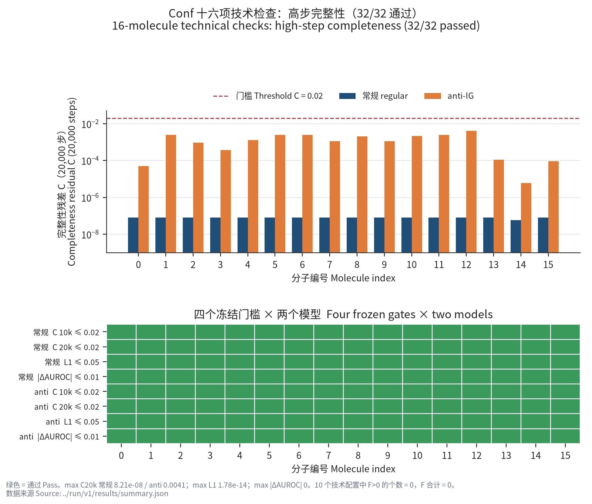
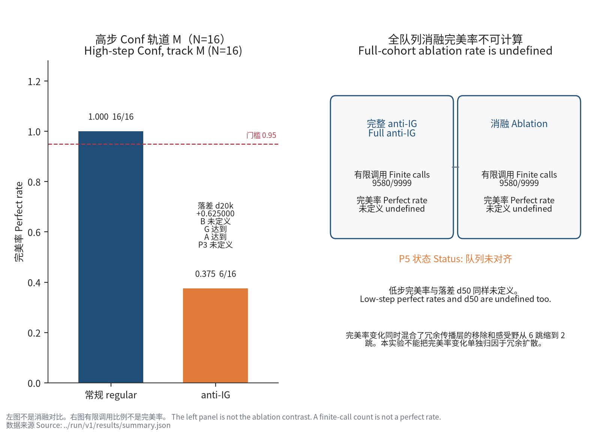
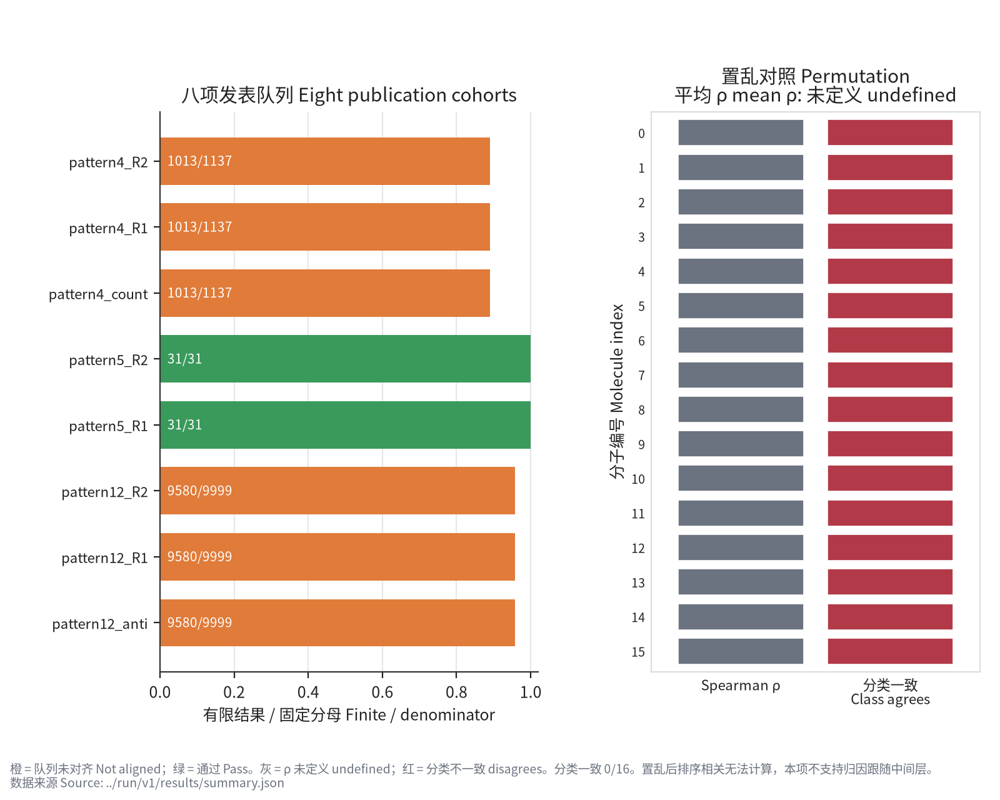

# R12 正式运行结果

正式运行 `R12run2` 已完成：`status=DONE`、`phase=finished`。全部结果数值来自公开的 [results/summary.json](results/summary.json)，该文件与正式汇总逐字节一致；最大值直接由其中的逐格记录汇总。预注册仍为锁定版本 [PREREG.md](PREREG.md)，锁定 SHA256：

```text
4ce2b21c61aa5509662068d989dec15a13f882f97ede5a347bc5d7875d6ba0fb
```

**机制主条款因队列未对齐无法判定，不是“科学上被否定”。** 资格出口先于机制科学判定；子域内调用完成、P2 通过或高步 Conf 达标均不能解除完整队列限制。CPU 环境与官方 CUDA 包锁不同，不能把本次运行当作官方 CUDA 环境的逐包复现。实现选择、恢复调度及并发调整见 [DEVIATIONS.md](DEVIATIONS.md)。

## 四元组终端

| 分量 | 正式终端 |
|---|---|
| 主终端 | 输入或实现资格不足：P0 队列未对齐、P3 低步队列未对齐。 |
| P4 总状态 | 队列未对齐 |
| P5 状态 | 队列未对齐 |
| 置乱句 | 置乱后排序相关无法计算，本项不支持归因跟随中间层。 |

缺失与超出冻结 CPU 子域的行保留在固定分母中；不以可运行子集替代完整队列，不把未定义量补成零，也不对未对齐项启用发表数字容差。

## P0：输入与实现资格

状态：**队列未对齐**。标签查找完整；汇总中的分类失败与技术失败标志均为 `false`，但完整队列资格仍不成立。分类分母与后面的阳性归因分母分别冻结，不能混用。

| Pattern | 模型 | 分类侧 | 固定分母 | 有限结果 | 超出 CPU 子域 |
|---|---|---|---:|---:|---:|
| 4 | regular | 阳性 | 1146 | 1022 | 124 |
| 4 | regular | 阴性 | 10000 | 9092 | 908 |
| 5 | regular | 阳性 | 34 | 34 | 0 |
| 5 | regular | 阴性 | 10000 | 7821 | 2179 |
| 12 | regular | 阳性 | 10000 | 9581 | 419 |
| 12 | anti | 阳性 | 10000 | 9581 | 419 |
| 12 | regular | 阴性 | 10000 | 9589 | 411 |
| 12 | anti | 阴性 | 10000 | 9589 | 411 |

各配置的缺失数等于超出 CPU 子域数。全部配置记录的调用失败、缺失或歧义标签、分类不一致及零基线失败数均为 0；这不代表完整队列全部成功。

## P1：两例机制检查（校准延续）

可读资格 `Q=true`；两例科学条件合取 `S=false`。各例条件按锁定顺序为：非 motif 原子、R2 单原子扫描不变、R1 单原子扫描变化、有符号 IG 与窗口贡献比达标、非 motif 占比达标。

| Pattern | Q | 五项条件 | S | C | 有符号 IG | 窗口贡献比 R | 非 motif 占比 L |
|---|---|---|---|---:|---:|---:|---:|
| 4 | true | true, false, true, true, true | false | 0.0024864142650329324 | 0.04107591386817773 | 1.0088354813696583 | 0.0691072416329351 |
| 5 | true | true, true, true, true, true | true | 0.0021003336633711456 | 0.008503250918234648 | 0.9995324414129143 | 0.014549403717223488 |

Pattern 4 的 R2 单原子扫描条件未成立；Pattern 5 的五项条件全部成立。两例均可读，以下是各自的排序描述；两例的 M 与 S 轨道标签及统计相同。

| Pattern | 轨道 | AUROC | AP | 完美排序 | L |
|---|---|---:|---:|---|---:|
| 4 | M / S | 0.9560439560439561 | 0.939533756841449 | false | 0.0691072416329351 |
| 5 | M / S | 0.9230769230769231 | 0.9945054945054943 | false | 0.014549403717223488 |

两例属于校准延续，其完整性只决定 P1 可读性，不参与 Conf 确认投票。P1 局部条件的事实不能改写已命中的主终端资格出口。

## P2：Conf 高步数值资格

冻结 Conf 的 16 个分子 × 两个模型共 32 格，全部完整且通过。每格同时核对两步完整性 C、归一化原子分数 L1 及两步 AUROC 差；全部 C 检查、L1 检查和 AUROC 差检查均达标，没有用平均值或达标比例替代逐格判定。积分步数、精度与门槛按锁定预注册执行。

| 模型 | 通过格数 / 固定格数 | 最大 C10k | 最大 C20k | 最大 L1 | 最大 AUROC 差 |
|---|---:|---:|---:|---:|---:|
| regular | 16/16 | 6.55217631262417e-08 | 8.214196345335267e-08 | 1.1102230246251565e-16 | 0.0 |
| anti | 16/16 | 0.008656313798146353 | 0.00409915220863688 | 1.7813875374805832e-14 | 0.0 |

逐格值及技术配置失败分母保留在 `summary.json` 的 `P2.cells` 与 `P2.technical_configurations` 中。该结果只覆盖冻结 Conf 清单。



## P3：高步完美率与低步资格

高步 Conf 的 M 与 S 轨道统计相同：

| 模型 | 有限 / 固定分母 | 完美数 / 分母 | 完美率 | AUROC | AP | L |
|---|---:|---:|---:|---:|---:|---:|
| regular | 16/16 | 16/16 | 1.0 | 1.0 | 1.0 | 0.0 |
| anti | 16/16 | 6/16 | 0.375 | 0.9898032431266447 | 0.9291666666666667 | 0.22708703433917649 |

高步完美率落差 `d20k=+0.625000`；高步落差条件 `G=true`、常规完美率条件 `A=true`。常规完美率的描述性 bootstrap 区间为 `[1.0, 1.0]`，anti-IG 为 `[0.125, 0.625]`。

低步常规与 anti-IG 各为有限 9580 / 固定分母 9999，均未对齐；低步完美率、`d50`、条件 `B` 及整体 `P3` 均未定义（JSON 为 `null`）。高步与低步队列不是同一总体，不能用 Conf 结果填补低步全队列结论。



## P4：发表数字复现

总状态：**队列未对齐**。下表逐项列出冻结分母、有限结果及是否允许启用容差。

| 项目 | 状态 | 固定归因分母 | 有限结果 | 调用失败 | 容差启用 |
|---|---|---:|---:|---:|---|
| pattern4_R2 | 队列未对齐 | 1137 | 1013 | 0 | 否 |
| pattern4_R1 | 队列未对齐 | 1137 | 1013 | 0 | 否 |
| pattern4_count | 队列未对齐 | 1137 | 1013 | 0 | 否 |
| pattern5_R2 | 通过 | 31 | 31 | 0 | 是 |
| pattern5_R1 | 通过 | 31 | 31 | 0 | 是 |
| pattern12_R2 | 队列未对齐 | 9999 | 9580 | 0 | 否 |
| pattern12_R1 | 队列未对齐 | 9999 | 9580 | 0 | 否 |
| pattern12_anti | 队列未对齐 | 9999 | 9580 | 0 | 否 |

未对齐项的 M/S 确认统计保持 `null`，不从有限子集计算完整队列的确认均值，不宣称这些发表数字“不通过”。实际规范键交集、仅原 CSV 有及仅重算有的集合见 [results/](results/) 中的 `overlap_*.json`。

### Pattern 5：两项通过的数值

R2 的 AUROC、AP、不完美数及逐分子 AUROC 容差条件全部成立；R1 的 AUROC、AP 及逐分子 AUROC 容差条件全部成立。通过判定用轨道 M，轨道 S 单列描述分母：

| 读出 | 轨道 | 分母 | 宏平均 AUROC | 宏平均 AP | 完美数 / 分母 | 完美率 | 不完美数 | 平均 L |
|---|---|---:|---:|---:|---:|---:|---:|---:|
| R2 | M | 31 | 0.9950372208436725 | 0.999645515774548 | 29/31 | 0.9354838709677419 | 2 | 0.0008367566812422968 |
| R2 | S | 22 | 0.993006993006993 | 0.9995004995004994 | 20/22 | 0.9090909090909091 | 2 | 0.0011790662326596 |
| R1 | M | 31 | 0.9889888337468983 | 0.995191421481744 | 26/31 | 0.8387096774193549 | 5 | 0.0008420772069404202 |
| R1 | S | 22 | 0.9844842657342657 | 0.9932242757242755 | 17/22 | 0.7727272727272727 | 5 | 0.0011865633370524104 |

两种读出的配对溢出均为 0.0，配对分母均为 22。M 与 S 宏平均分母不同，配对溢出不能由表中两列宏平均直接相减得到。固定报告句为：“本队列上两套标签的宏平均 AUROC 差距小于 0.02。”



## P5：传播层消融

状态：**队列未对齐**。消融与完整 anti-IG 的阳性归因结果各为有限 9580 / 固定分母 9999；两者的 M/S 统计均为 `null`，不能计算完整队列上的完美率提高或平均 L 下降。调用失败数为 0，并不解除缺失及队列限制。

**完美率变化同时混合了冗余传播层的移除和感受野从 6 跳缩到 2 跳。本实验不能把完美率变化单独归因于冗余扩散。**

## 置乱对照与结论范围

置乱模型 16/16 全零归因；Spearman rho 在全部 16 个分子上未定义，平均 rho 为 `null`，不是零相关。分类一致率为 0.0。分母、未定义相关及分类一致率来自 `summary.json` 的 `permutation`；“全零归因”性质已与只读逐调用 CSV 的 `all_zero` 标记核对，未增改公开汇总字段。

置乱后排序相关无法计算，本项不支持归因跟随中间层。

Pattern 12 的两套 SMARTS 相同，溢出按定义为 0。

这些结果仅涉及受控白盒、两例指定机制分子、冻结归因定义及相应队列。P2 和 P3 高步不能外推到 Pattern 12 全队列、单片段醛队列、其他 motif 或自然分布。三张图引用正式汇总；图中的有限调用比例不是完美率，未定义相关及缺失全队列统计保持未定义。

## 公开材料

- [results/summary.json](results/summary.json)：正式汇总原样复制，包含判定条件、双轨统计及描述性区间。
- [results/configurations.json](results/configurations.json) 与 `results/overlap_*.json`：配置执行状态及规范键集合审计。
- [DEVIATIONS.md](DEVIATIONS.md)：已检查脱敏的实现与恢复记录，全部路径为相对路径。
- [SHA256SUMS](SHA256SUMS)：公开文件校验清单；预注册与外部锁定文件保持原字节。

原始数据库、内部运行目录、完整节点与积分轨迹及大 CSV 不纳入公开仓库。

## English abstract

R12 formal execution is complete. The ordered terminal is input or implementation qualification insufficient: P0 and the P3 low-step cohort are not aligned. P4 overall and P5 also retain the cohort-not-aligned status. The main mechanism clause is therefore undecidable under the locked qualification gates; this is not a scientific rejection.

All 32 molecule-model cells on the locked 16-molecule Conf panel passed completeness, normalized-score L1 and AUROC-stability checks. High-step perfect-ranking rates were 1.0 (16/16) for the regular model and 0.375 (6/16) for anti-IG, with gap 0.625. Both Pattern 5 readouts passed their locked replication criteria. The two mechanism examples remain calibration continuations: both are readable, while their joint scientific conditions are not all met.

The permuted model produced all-zero attributions for 16/16 molecules, making every Spearman rho undefined; this item does not support attribution following intermediate layers. Full-cohort ablation statistics are undefined. Any perfect-rate change mixes propagation-layer removal with a receptive-field reduction from 6 to 2 hops. The CPU environment differs from the official CUDA package lock. Conclusions from Conf apply only to its frozen panel. All reported result numbers are sourced from the unchanged public summary; the all-zero property was checked against read-only per-call records.
